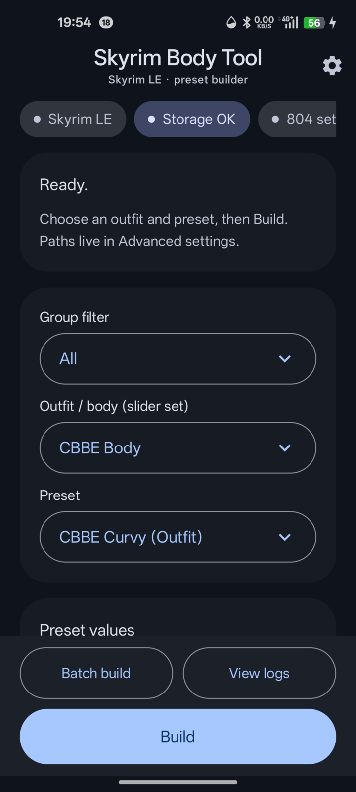

# Body Tool (Android)

An Android app that builds Skyrim Legendary Edition outfit, body and clothing meshes from BodySlide presets on device. It reads a BodySlide project, applies the selected preset to the sets you choose, and writes an installable mod zip. Built for static Skyrim LE Android ports, where the desktop BodySlide workflow means copying a project off the phone and the meshes back on.

The main build has no launcher icon; Skyrim Mod Loader lists it in its plugin section and starts it from there. A second build adds a normal drawer icon for anyone who wants one.



## What it does

- Applies one preset to every set you build: body, armor and clothing, including zap sliders that remove covered skin shapes.
- Batch builds every set in a group filter. 111 sets take about 15 seconds on a OnePlus 9.
- Resolves output conflicts per file. When sets write the same `_0.nif`/`_1.nif`, pick the winner and skip the rest for that file only.
- Writes a mod zip with game-relative paths (`meshes/...`), named after the mod name you enter.
- Streams output into `<name>.zip.part` and renames it on success, so a failed build cannot truncate a previous good zip.
- Controls slider values from the preset: no manual editing, no pinned preview.
- Records the last build step and writes `crash-last.txt` if a build dies; both are reported in the log at the next launch.


## Requirements

- Android 7.0 (API 24) or newer, `arm64-v8a`.
- All files access. Projects and mod zips live on shared storage, so the app needs real file paths.
- Skyrim Mod Loader if you use the iconless build, which starts the app from its plugin section.
- A Skyrim Legendary Edition static Android port. Special Edition and Fallout 4 are not supported.
- A BodySlide project folder with `SliderSets`, `SliderPresets`, `SliderGroups` and `ShapeData`, for example `CalienteTools/BodySlide` from CBBE, HIMBO or a refit pack.

## Usage

1. Download one of the two APKs from [Releases](https://github.com/TweakerZ/skyrim-body-tool/releases). `BodyTool-<version>.apk` has no launcher icon; open it from the plugin section of Skyrim Mod Loader. `BodyTool-<version>-launcher.apk` is the same app with a drawer icon. Both accept updates over each other.
2. Open **Advanced settings** and set the BodySlide project folder, the game/mod data folder and the output folder.
3. Pick a group filter, an outfit and a preset. **Preset values** shows what the preset applies.
4. **Build** one set or **Batch build** the current filter, then install the resulting zip with your mod loader.

## Building

Requires JDK 17, an Android SDK with build-tools 34, NDK `27.3.13750724` and CMake `3.22.1`.

```bash
git clone --recursive https://github.com/TweakerZ/skyrim-body-tool.git
cd skyrim-body-tool
echo "sdk.dir=/path/to/Android/sdk" > local.properties
./gradlew :app:assemblePluginRelease :app:assembleLauncherRelease
```

The iconless build lands in `app/build/outputs/apk/plugin/release/` and the drawer-icon build in `app/build/outputs/apk/launcher/release/`. `./gradlew :app:assembleRelease` builds both.

Release signing reads `keystore.properties` from the project root:

```properties
storeFile=/absolute/path/to/your.jks
storePassword=...
keyAlias=...
keyPassword=...
```

Without that file the release build is unsigned. The Compose components come from the vendored `skyrim-suite-ui` sources in `suite-ui/`, so a fresh clone builds on its own.

## Layout

- `app/src/main/cpp/` – build core: slider set and preset parsing, morph application, NIF read/write.
- `app/src/main/` – manifest with the Skyrim Mod Loader action and no launcher entry; `app/src/launcher/` adds the drawer icon.
- `app/src/main/java/com/bodyslide/android/` – project scanning, preset parsing, conflict resolution, zip packaging and the Compose UI.
- `app/src/main/cpp/third_party/` – `nifly` submodule and `tinyxml2`.
- `suite-ui/` – shared Compose components used by the Skyrim Android tools.

## Suite

- [Skyrim Mod Loader](https://github.com/TweakerZ/Skyrim-Mod-Loader) installs mods, orders plugins and deploys the game folder.
- [Skyrim Anim Tool](https://github.com/TweakerZ/skyrim-anim-tool) manages FNIS Behavior options, patches and scripts.
- [LOOT Android](https://github.com/TweakerZ/loot-android) sorts plugin load order.

## Credits

A port of the [BodySlide and Outfit Studio](https://github.com/ousnius/BodySlide-and-Outfit-Studio) build step by Ousnius and Caliente, GPL-3.0. Mesh parsing and writing use [nifly](https://github.com/ousnius/nifly); XML parsing uses tinyxml2. See [THIRD_PARTY_NOTICES.md](THIRD_PARTY_NOTICES.md) for the full list and [LICENSE](LICENSE) for the GPL-3.0 text.

This is an unofficial fan tool. Skyrim and its assets belong to Bethesda Softworks.

> [!NOTE]
> Yes, AI was used in building this.