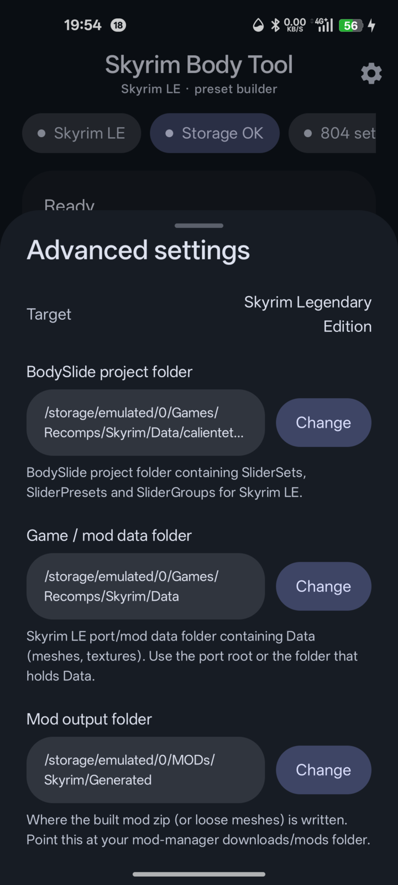

# Skyrim Body Tool

Apply BodySlide presets to Skyrim Legendary Edition outfits, bodies and clothing on an Android phone, then pack the built meshes into a mod zip you can install with a mod loader.

This is an unofficial Android port of the BodySlide build step, written for the static Skyrim LE Android ports. It does not need a PC, Wine or a Windows emulator, and it produces the same kind of `meshes/...` output the desktop tool writes.

<p>
  
  
</p>

## What it does

- **Preset-driven builds.** Pick a preset once and it is applied to every set you build. Slider values are composed from the set's own definitions, weight-0 defaults and the preset; nothing has to be edited by hand.
- **Works on outfits, not just bodies.** Armor, clothing and body sets all go through the same build path, including zap sliders that remove covered skin shapes.
- **Batch builds.** Build one outfit or every set matching a group filter. A 111-set batch runs in roughly 15 seconds on a OnePlus 9; 400+ sets are supported.
- **Conflict handling.** Several outfits often write the same `_0.nif`/`_1.nif`. Before building, the app groups sets by output file and lets you pick the winner per file. The losers are skipped for that file only.
- **Installable output.** Built meshes are written into a zip with game-relative paths (`meshes/armor/...`), named after the mod name you enter, ready for a mod loader.
- **Progress and diagnostics.** Per-set progress, a capped build log, a checkpoint file every 20 sets, and a crash report (`crash-last.txt`) that records the last build step, heap size and stack trace.
- **No damage on failure.** One bad set fails alone. The zip is streamed to `<name>.zip.part` and renamed when complete, so a kill or a crash cannot truncate a previously good build.

## Requirements

- Skyrim **Legendary Edition** (not Special Edition, not Fallout 4) running through a static Android port.
- An `arm64-v8a` Android device, Android 7.0 (API 24) or newer.
- A BodySlide project folder containing `SliderSets`, `SliderPresets`, `SliderGroups` and `ShapeData` — normally the `CalienteTools/BodySlide` folder from CBBE, HIMBO, a refit pack or a similar mod.
- The mod data folder the port actually reads (`.../Data`), so the shape morph data can be resolved.

## Install

1. Download the APK from [Releases](../../releases).
2. Allow installs from your browser or file manager, then open the APK.
3. Launch the app and grant **All files access**. Real filesystem paths are needed to read mod projects and write the finished zip; scoped storage cannot reach them.

If the APK will not install over an older build, uninstall the old app first. Releases are signed with the project key, so a debug build cannot be updated in place.

## Usage

1. Open **Advanced settings** (the gear) and set:
   - **BodySlide project folder** — the folder with `SliderSets` / `SliderPresets` / `SliderGroups`.
   - **Game / mod data folder** — the folder holding `Data` (meshes and the ShapeData used by the sets).
   - **Mod output folder** — where the zip is written; usually your mod-manager downloads folder.
2. Pick a **group filter** and an **outfit / body**.
3. Pick a **preset**. The read-only *Preset values* card shows what will be applied to the selected set.
4. Set the **mod name** (it becomes the zip filename) and leave **Package built meshes as a mod zip** enabled.
5. Tap **Build** for one set, or **Batch build** for every set in the current filter.
6. Install the resulting `<mod name>.zip` with your mod loader.

Sets are never modified. Only the built NIFs are written, and only into the output folder or zip.

## How it works

- `app/src/main/cpp/bs_build.cpp` is the build core: it parses slider sets/presets, resolves the meshes each set needs, applies shape morphs and writes NIFs through [nifly](https://github.com/ousnius/nifly). It follows the behaviour of BodySlide and Outfit Studio's outfit build.
- The Kotlin side scans the project, indexes presets and groups, resolves per-output-file conflicts, and assembles the zip. Parsing and building run on `Dispatchers.IO`; the UI thread never touches JNI during a batch.
- Slider-set XML with a UTF-8 BOM is handled explicitly: the native parser is authoritative and the Kotlin XML parser is only a fallback.
- Built file paths inside the zip are relative to the game data folder, so the archive root is `meshes/`.

## Build from source

Prerequisites:

- JDK 17
- Android SDK 34 and build-tools
- Android NDK `27.3.13750724`
- CMake `3.22.1`

```bash
git clone --recursive https://github.com/TweakerZ/skyrim-body-tool.git
cd skyrim-body-tool
echo "sdk.dir=/path/to/Android/sdk" > local.properties
./gradlew assembleDebug
```

The `nifly` submodule is required; `--recursive` or `git submodule update --init --recursive` fetches it.

For a signed release build, create a keystore outside the repository and add a `keystore.properties` file at the project root (it is gitignored):

```properties
storeFile=/absolute/path/to/release.jks
storePassword=...
keyAlias=...
keyPassword=...
```

Then run `./gradlew assembleRelease`. Without `keystore.properties` the release variant builds unsigned.

## Suite

Part of a set of Android tools for Skyrim LE static ports:

- [Skyrim Mod Loader](https://github.com/TweakerZ/Skyrim-Mod-Loader) — mod management, install order and launching the game with a chosen profile.
- [Skyrim Anim Tool](https://github.com/TweakerZ/skyrim-anim-tool) — FNIS Behavior options, patches and script management.
- [LOOT Android](https://github.com/TweakerZ/loot-android) — load-order sorting and plugin conflict checks.
- [Skyrim Body Tool](https://github.com/TweakerZ/skyrim-body-tool) — this app: BodySlide preset builds on device.

## Credits

This project is a derivative work. Most of the hard parts are other people's work:

- **[BodySlide and Outfit Studio](https://github.com/ousnius/BodySlide-and-Outfit-Studio)** — Ousnius and Caliente, GPL-3.0. The build pipeline, slider-set/preset semantics and NIF output behaviour implemented here come from BodySlide and Outfit Studio.
- **[nifly](https://github.com/ousnius/nifly)** — Ousnius, GPL-3.0. NIF parsing and writing (pinned at `40584be`).
- **[tinyxml2](https://github.com/leethomason/tinyxml2)** 11.0.0 — Lee Thomason, zlib licence. XML parsing for slider sets and presets.
- **CBBE** — Caliente and Ousnius. Slider sets and presets used as the reference implementation and for testing.
- **Remodeled Armor for CBBE BodySlide HDT Replacer** — CT77. Outfit sets used for testing the armor/refit build path.
- **Jetpack Compose and Material 3** — Android Open Source Project, Apache-2.0. Application UI.
- The suite's shared Compose components live in `suite-ui/` in this repository; they are also used by the other apps above.

Skyrim, The Elder Scrolls and related marks are trademarks of Bethesda Softworks LLC. This project is unofficial and is not affiliated with or endorsed by Bethesda Softworks, Ousnius, Caliente or CT77. No game assets are bundled; meshes are generated from mods installed on your own device.

## Licence

GPL-3.0. See [LICENSE](LICENSE) and [THIRD_PARTY_NOTICES.md](THIRD_PARTY_NOTICES.md).

The project is GPL-3.0 because it is derived from BodySlide and Outfit Studio and links nifly, both of which are GPL-3.0. If you redistribute a modified APK, the corresponding source must be available under the same licence.
